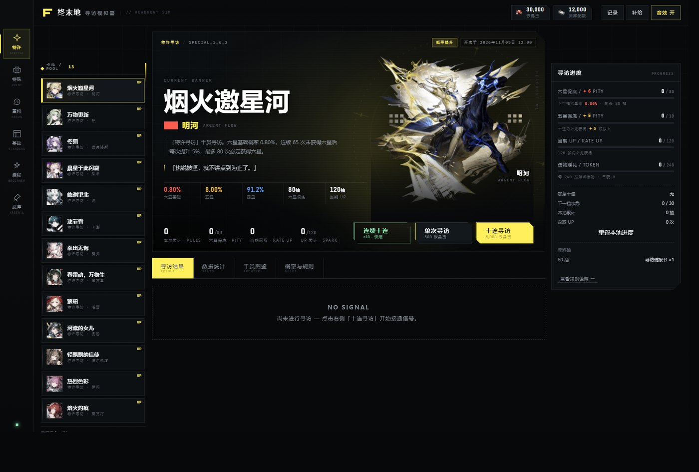
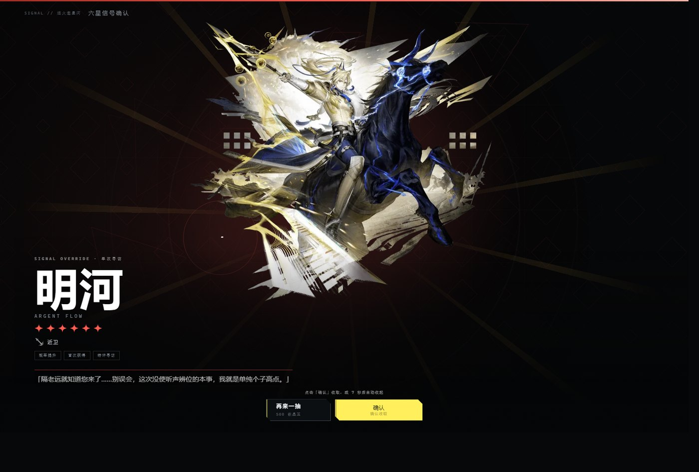
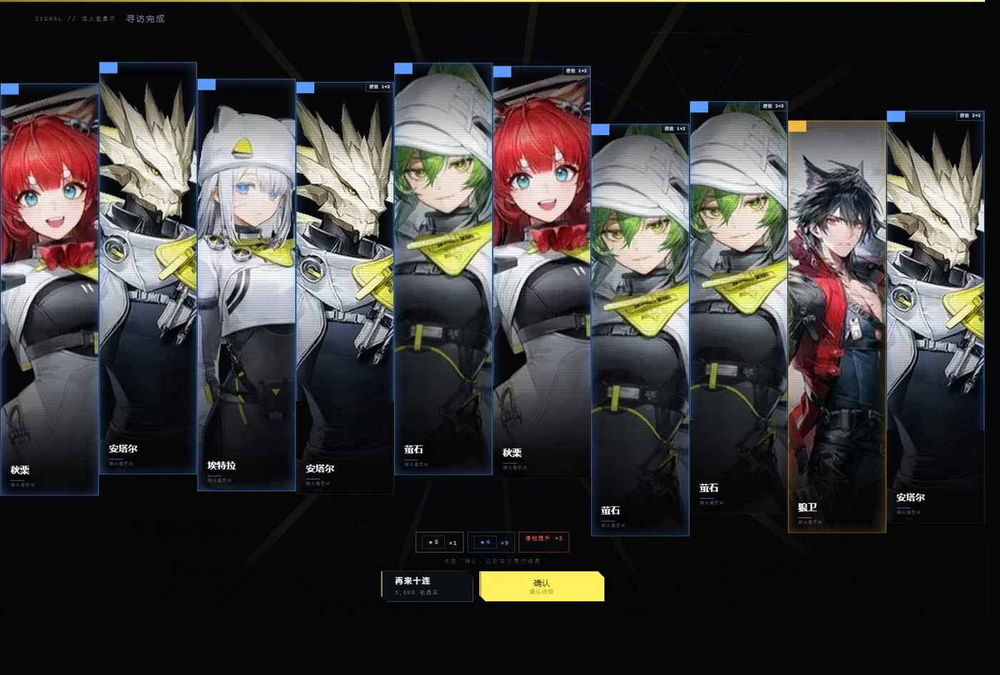
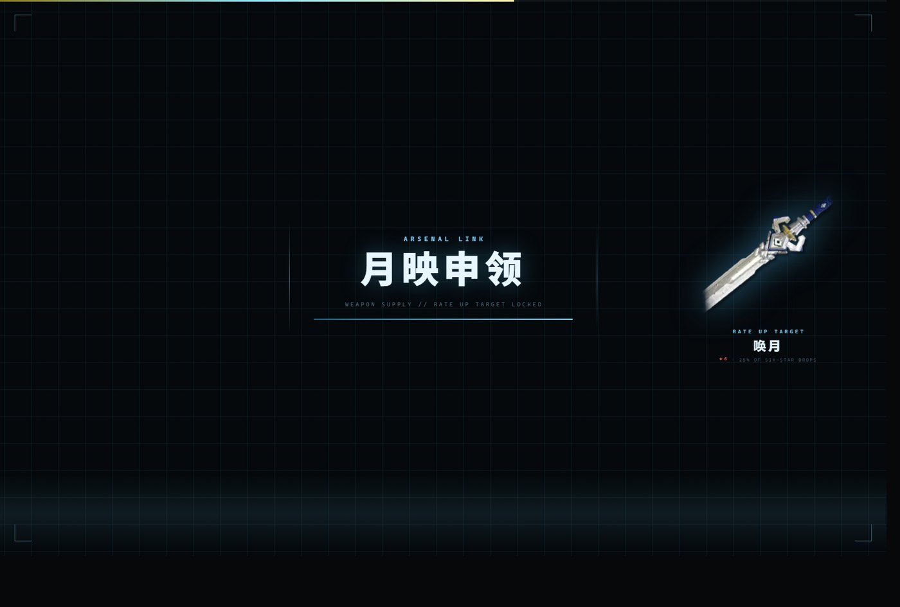
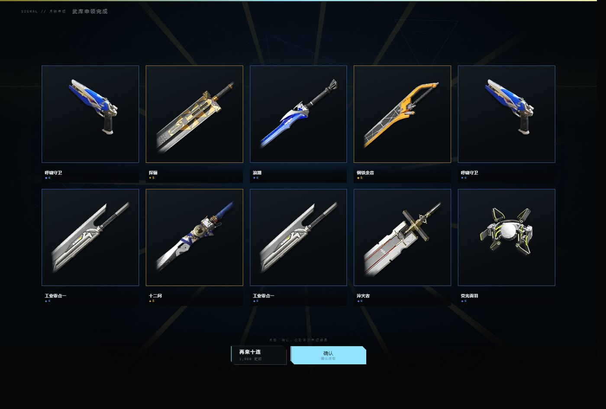
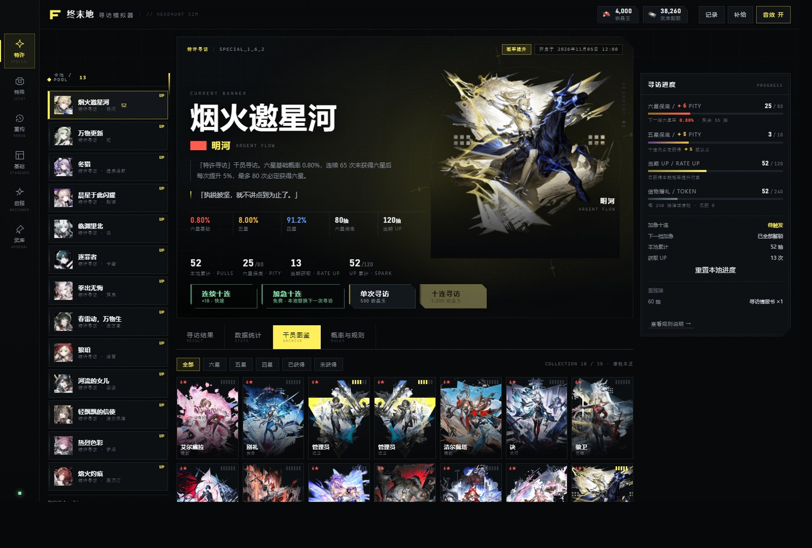
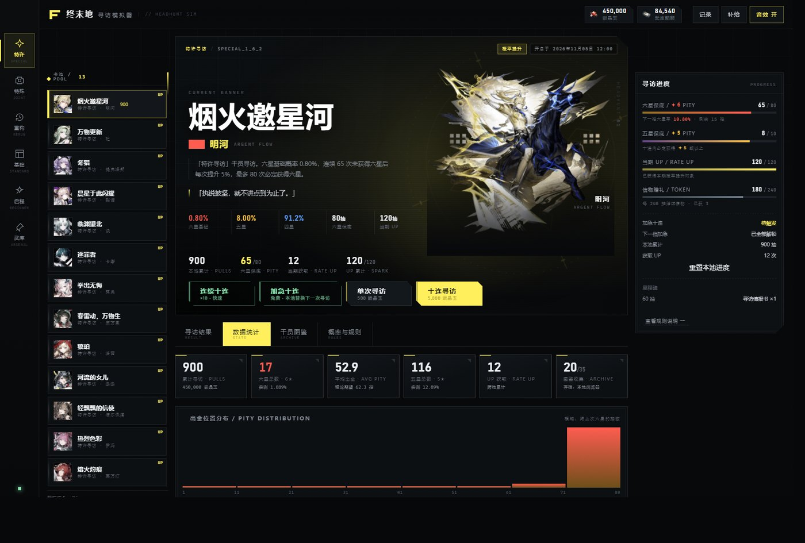
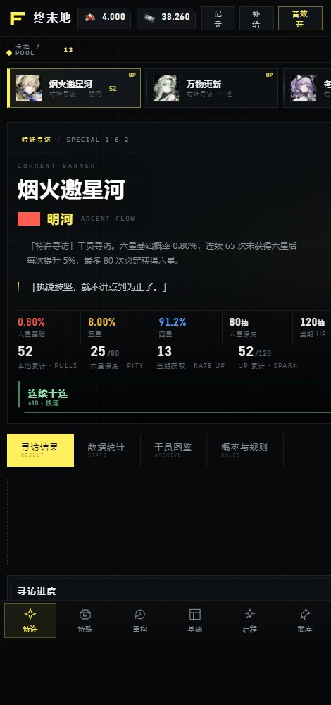

# 终末地 · 寻访模拟器

《明日方舟：终末地》的抽卡模拟器，纯静态网页：卡池数据、概率与保底规则按 [终末地 Wiki](https://www.fz.wiki/) 的卡池说明实现，立绘、头像与武器图取自同一站点的资源库。

- 在线试玩：<https://qingyu107.github.io/endfield-gacha/>
- 离线使用：双击 `index.html`，不需要服务器，也不需要联网



## 内容规模

| 项 | 数量 |
| --- | --- |
| 角色卡池 | 18（特许寻访 13 期、辉光庆典、重构寻访 2 期、基础寻访、启程寻访） |
| 武器卡池 | 22 |
| 干员 | 35（含管理员·男/女、噗切娜） |
| 武器 | 64 |
| 潜能 | 每人 5 级，词条照游戏内文本录入 |

## 抽卡规则

角色池按 Wiki 的概率表实现：

- 六星 0.80%，五星 8.00%，四星 91.20%
- 连续 65 次没出六星后，每抽提高 5 个百分点：第 66 抽 5.8%，第 79 抽约 70.8%，第 80 抽必出；出六星后回到 0.80%
- 五星有 10 抽保底，出五星或以上后重新计数
- 出六星时 50% 为当期 UP，本池累计 120 抽必得 UP（每池只生效一次）
- 每 240 抽送一个信物
- 本池累计 30 抽触发一次「加急招募」：下一次寻访被替换成免费十连，结果不计保底、不计累计次数，卡池关闭即失效，不能存到下一期
- 启程寻访有 40 抽上限，基础寻访走自选交货

武器池（武库申领）每申领一次得 10 件，必含五星或以上：

- 六星 4%，五星 15%，四星 81%
- 连 3 次没出六星，第 4 次必出；前 7 次没出 UP 武器，第 8 次必出（每池一次）
- UP 武器占六星产出的 25%

概率逻辑有自测脚本 `tools/sim_engine.js`：Node 跑 15 万次单抽，实测六星 1.89%、五星 13.40%，平均 53 抽一个六星，与官方公示的综合概率一致。

## 抽卡演出

入场卡跟着这一抽的结果换色：全四星蓝色、有五星黄色、有六星红色。出六星时有 42% 的概率走彩蛋：先按黄色亮起，中途闪一下转红。


单抽（任何稀有度）和十连出六星时，先进立绘展示页，放完再进结果。展示页会显示该干员在 Wiki 收录的一句台词；六星同时播放对应角色的官方中文配音，没有收录的角色保持静默（不做合成配音）。十连是十张竖条半身像，高低随机错开，六星卡带扫光和脉冲描边。




武器池单独一套场景：申领时进蓝图界面，网格、四角框、青色进度条；结果用 5×2 机架展示，五星金框、四星蓝框。




## 语音与台词

台词和配音都来自 Wiki 的干员页（`干员/<名字>` 里的「干员频道」台词块），音频是站内 `voice.fz.wiki` 的真实录音，转成 72k 单声道 mp3 后随页面离线打包：

- 33 名干员有台词文本，展示页会引一句（闲聊·友好 优先）
- 六星里 18 名有官方中文配音，展示页直接播放
- 管理员·男/女没有词条，展示时只出文字、不放声音
- 明河在 Wiki 上的音频是死链，这段「干员报到」是从官方中文语音集里切出来的单句（6.95 s）

18 条语音合计约 1.6 MB，没有一条是合成音。

## 其他页面

图鉴按稀有度和获得状态筛选，点开能看潜能词条；统计页有出金位置分布和平均抽数；规则页列出当前卡池的原文说明。进度、持有、历史都存 localStorage。




手机竖屏下十连改成 5 列 2 行，按钮和进度条一起重排：



## 本地运行

```bash
# 直接打开
start index.html

# 或者起静态服务器（音效和 BGM 在 file:// 下可用，走 http 更稳）
python -m http.server 8080
```

第一次打开有一段资源预载动画，走完即可开始。

调试用的 URL 参数：

| 参数 | 作用 |
| --- | --- |
| `?pool=<id>` | 直接打开指定卡池，如 `special_1_6_2`、`weaponbox_1_6_2` |
| `?sim=20` | 静默抽 20 次十连，用来攒统计数据 |
| `?static=1` / `?still=1` | 关掉动画，给无头浏览器截图用 |
| `?lucky=1` | 把随机数压到 0.2% 以内，必出六星 |

## 目录结构

```
index.html              页面骨架
css/app.css             全部样式（工业扁平风、三角菱形装饰、响应式）
js/engine.js            卡池、概率、保底、加急、奖励、存档
js/ui.js                渲染、抽卡流程、演出
js/audio.js             音效合成播放 / BGM / TTS 语音
js/fx.js                canvas 粒子与线框背景
data/data.js            卡池 / 干员 / 武器 / 职业数据
data/_raw.json          Wiki 原始抓取结果
data/potentials.json    潜能词条
data/bust_anchors.json  立绘裁切锚点
assets/stage/           原始立绘
assets/bust/            竖条半身像（320 宽，十连与单抽都用它）
assets/icon/            官方头像（只用来定位头部，不当卡面）
assets/orn/             SVG 装饰件
assets/ui/              星星等 UI 素材
audio/                  音效与 BGM
docs/showcase/          README 截图
tools/                  抓取与生成脚本
```

## 重新生成数据

```bash
python tools/scrape.py          # 卡池与干员 → data/_raw.json
python tools/scrape_weapons.py  # 武器池
python tools/scrape_cards.py    # 潜能留影
python tools/scrape_prof.py     # 职业图标
python tools/build_data.py      # 生成 data/data.js
python tools/build_assets.py    # 立绘、图标转 webp
python tools/build_stage.py     # 生成展示版立绘
python tools/build_bust2.py     # 生成半身裁切（ORB + SIFT 定位头部）
python tools/audio_gen.py       # 重新合成音效
node tools/sim_engine.js        # 概率自测
```

依赖 Python 3 + numpy + Pillow，`ffmpeg` 用于 mp3 编码，`opencv-python` 用于立绘定位。

半身像不是一张张手工裁的：`tools/build_bust2.py` 把官方头像的特征点匹配到立绘上，反推出头部坐标，再按固定比例开窗，让头落在画面 15%~20%、胸部以上入画。匹配不可靠的几张（噗切娜、骏卫）在脚本里留了手工锚点。

## 素材来源

- 卡池数据、概率规则、立绘、头像、武器图：终末地 Wiki（`fz.wiki` / `assets.fz.wiki`）
- BGM：《明日方舟：终末地》祀 EP「花祀时 / 何处山海万象生」，B 站 [BV19ZJ66sEYZ](https://www.bilibili.com/video/BV19ZJ66sEYZ)，截 62 秒循环段
- 音效：`tools/audio_gen.py` 用 numpy 合成，不是游戏原声
- 语音：浏览器 SpeechSynthesis 朗读干员名，效果取决于系统语音包

同人作品，非官方。干员立绘、图标、名称版权归上海鹰角网络科技有限公司所有，仅用于学习与娱乐；模拟器不涉及任何真实消费，资源可在「补给」面板自由补充。
